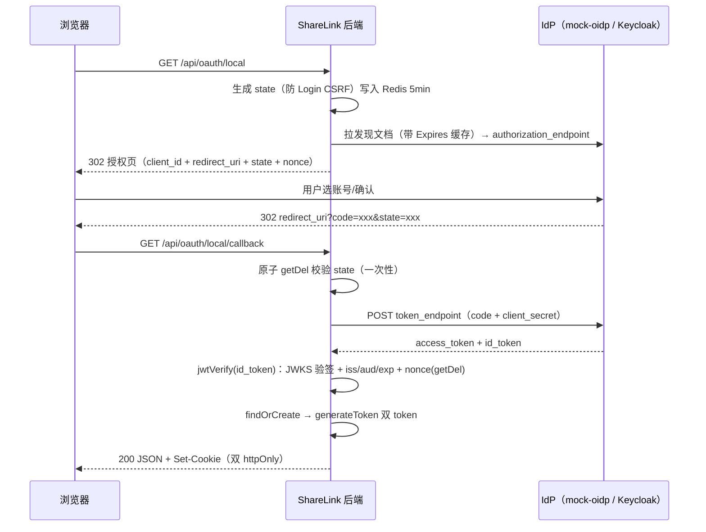

# ShareLink 第三方登录方案（OAuth / OIDC / GitHub）

> 面试学习文档 · 与代码全量同步（2026-10-03）
> 姊妹篇：[token-scheme.md](./token-scheme.md)（JWT 双 token 体系）

---

## 前置知识：为什么有 OAuth——从"密码反模式"说起

> 本文档 §1 讲四个名词、§3/§4 讲两条实现路径；本节先讲这些设计背后的"为什么"。

### 1. 密码反模式（OAuth 要解的原始问题）

第三方应用要访问你 GitHub 上的数据，最 naive 的做法是把 GitHub 密码给它——三个致命问题：**密码全暴露**（对方能干任何事）、**无法限权**（不能表达"只读仓库、不能删号"）、**无法单独吊销**（只能改自己的密码）。OAuth 2.0 就是为解决它而生：**授权而不给密码**。

### 2. OAuth 2.0 的四个角色与核心思想

资源所有者（用户）/ 客户端（第三方应用）/ 授权服务器（发令牌）/ 资源服务器（数据 API）。核心流程：客户端把用户**重定向到授权服务器**登录 → 用户同意 → 客户端拿到**限权（scope）+ 限时**的 access_token——全程见不到用户密码。

### 3. 授权码模式（authorization code）为什么是主流

四种模式里只有它适合"有后端的 Web 应用"：code 先回跳到前端，**token 的交换在服务器与授权服务器之间完成**，token 不经过浏览器——防泄漏。微信登录、GitHub 登录跳来跳去的那个流程就是它。

### 4. OAuth ≠ 登录：OIDC 补身份层（本项目用到的关键区分）

OAuth 解决"**授权**"（能干什么），不回答"你是谁"——拿到的 token 是访问凭证，不是身份凭证。**OIDC（OpenID Connect）= OAuth 2.0 + 身份层**：标准化 id_token（JWT 载荷含用户身份声明）+ /userinfo 端点。"用 GitHub 登录"是 OIDC 场景；本项目两条路径的选型差异（§3 OIDC 拿 id_token / §4 GitHub OAuth App 拿 access_token 再调 API 取身份）根源就在这层。

### 5. 术语速查

| 术语 | 一句话解释 |
|---|---|
| client_id / client_secret | 应用在 IdP 注册的身份标识与密钥 |
| redirect_uri | 授权后跳回地址——必须预登记，防授权码劫持 |
| scope | 授权范围（限权的表达） |
| authorization code | 一次性中间码，后端用它换 token |
| access_token / id_token | 访问凭证 / 身份凭证（OIDC 特有） |
| IdP | Identity Provider，身份提供方（GitHub、Keycloak） |
| PKCE | 授权码 + 动态验证，纯前端无后端客户端的防劫持增强 |

## 0. 一句话总纲

> **身份关联用"提供商保证永不改变的标识"（OIDC `sub` / GitHub 数字 `id` / LDAP `objectGUID`）存独立的 `UserIdentity` 绑定表；邮箱只是首次注册的初始属性，永远不做关联键。所有提供商认证完成后汇合到同一个 `generateToken`，与密码登录共享整套双 token 会话治理。**

---

## 1. 先搞懂四个名词

**OAuth 2.0 —— 授权框架（"允许它替我做事，但别把密码给它"）**

RFC 6749 定义的行业标准和基础协议。解决的问题是**授权委托**：用户（资源拥有者）在不把密码交给第三方应用（客户端）的前提下，授权它访问自己存在别处的资源（如"让简历工具读取我的 GitHub 仓库"）。四角色：资源拥有者 / 客户端 / 授权服务器 / 资源服务器；核心流程是**授权码模式**（authorize 拿 code → code + client_secret 换 access_token）。关键认知：OAuth 2.0 **只管授权、不管认证**——access_token 是"取件凭证"，不是"这个用户是谁"的身份证明。

**OIDC（OpenID Connect）—— OAuth 2.0 的身份层（"顺便告诉我你是谁"）**

构建在 OAuth 2.0 之上的开放标准。既然大家拿 OAuth 拿到 access_token 后都还要再调一次"用户信息接口"（且各家格式不一），OIDC 把这一步标准化：token endpoint 额外返回一个 **ID Token**（JWT 格式），内含 `sub`（用户唯一标识）、`email` 等标准化字段，验签即身份。一句话：**OIDC = OAuth 2.0 + ID Token**。Google / 微软 / Apple / Keycloak 都支持，接入任何一家只需 issuer 域名 + client 凭证（端点从发现文档自动获得）。

**LDAP（Lightweight Directory Access Protocol）—— 企业内网的目录协议（"去公司通讯录查这个人、验这个密码"）**

轻量目录访问协议，操作的是树形"目录数据库"——公司把员工账号、部门、权限组统一存进 **Active Directory（微软域控）或 OpenLDAP**，内网所有系统共用这一份账号。业务系统登录 = 拿用户输的工号+密码**直连** LDAP 服务器验证（两步 bind：先用服务账号搜到用户 dn，再用 dn+密码绑定验证）。它是 TCP 直连协议、密码经过你的后端转发——和 OAuth 类"跳转到第三方页面、零接触密码"是两个物种。常见属性：`dn`（条目全路径，会变）、`objectGUID`（唯一标识，不变）、`mail`、`memberOf`（所属组）。

**GitHub OAuth App —— GitHub 的第三方登录（标准 OAuth2 + REST）**

GitHub 在 OAuth 2.0 授权码模式上叠加一组 REST API 完成登录：`/login/oauth/authorize` 拿 code → `/login/oauth/access_token` 换 access_token → 凭 token 调 `/user`、`/user/emails` 取资料。它是**标准 OAuth2 但不是 OIDC**——没有发现文档、没有 JWKS、没有 ID Token，身份资料全靠 REST 查询；身份标识是数字 `id`（`login` 用户名可改名）。

> **统一视角**：OAuth / OIDC / GitHub 是同一类——HTTP 跳转 + token 的互联网授权体系，密码不在你手里；LDAP 是另一类——TCP 直连 + 后端转发验证的企业内网体系，密码过你的手。前者体验同构（跳出去→回 callback），后者实现同构（直连验证→upsert 本地账号）。

### 三种登录源的定位对比

| | 密码登录 | OIDC（Keycloak/本地 IdP） | GitHub OAuth |
|---|---|---|---|
| 验证方 | 自己（argon2） | IdP 托管页 | GitHub 托管页 |
| 协议形态 | 本地表单 | 标准授权码 + ID Token | 标准授权码 + REST API（**无 ID Token**） |
| 密码经手 | 存哈希 | 不经手（托管页输入） | 不经手（托管页输入） |
| 不可变标识 | `user.id` | `sub` | 数字 `id`（退而求其次才是 `login`，**不推荐**） |
| 邮箱 | 必填，可验证 | 有（可能带 `email_verified`） | 有，但可能**取不到**（私有邮箱未授权 scope） |
| 汇合点 | `generateToken` 双 token | 同左 | 同左 |

**为什么 GitHub 不继承 GenericOidcProvider**（高频考点）：GitHub 是标准 OAuth2 授权码 + REST，不是 OIDC——
- 无发现文档、无 JWKS、无 ID Token（身份资料凭 access_token 调 REST API）
- token 端点必须带 `Accept: application/json`（否则返回 query string 而非 JSON）
- GitHub API 强制 `User-Agent` 头，缺失直接 403；业务失败时 **HTTP 仍是 200**，错误在响应体 `error` 字段

所以 `GithubProvider implements OAuthProvider`（接口），`LocalOidcProvider extends GenericOidcProvider`（抽象类）——两条路径，一个接口，编排层零改动。

---

## 2. 身份关联模型（本方案的核心决策）

### 2.1 UserIdentity 绑定表

```prisma
model UserIdentity {
  id         String @id @default(uuid())
  provider   String   // 'github' | 'oidc:keycloak' | 'ldap'
  providerId String   // sub / 数字 id / objectGUID —— 提供商保证永不改变
  userId     String
  user       User     @relation(fields: [userId], references: [id], onDelete: Cascade)

  @@unique([provider, providerId])  // 一个外部身份只能绑一个本地账号
  @@index([userId])
}
```

- **为什么独立表而不是 User 表加字段**：一个用户可绑多个第三方（GitHub + Keycloak 同一人）；字段方案做不到，且会污染用户模型
- **为什么 `providerId` 不用邮箱**：邮箱是**属性**不是**身份**——可变、可信度参差（`email_verified` 只代表注册那一刻验证过）、自动合并不可逆
- **为什么 LDAP 不存 `dn`**：用户改名/调部门 dn 就变（`uid=zhangsan,ou=...` 是路径）；真正不变的是 AD `objectGUID` / 标准 LDAP `entryUUID`。旧后端 `User.ldapDN` upsert 就是这个雷：组织架构调整一次，全员匹配不上、静默建重复号

### 2.2 findOrCreate 三分支（安全铁律）

```text
callback 拿到 (provider, providerId)
  ├─ ① UserIdentity 命中        → 直接拿 userId 登录（sub 永不变，邮箱改了也无所谓）
  ├─ ② 未命中 + email_verified  → 自动注册【新用户】（email 做初始属性 + 写绑定）
  │      ⚠️ 只创建新账号，绝不按 email 认领已有账号 —— 认领 = 账号接管漏洞
  └─ ③ 未命中 + 无可用邮箱（GitHub 私有邮箱） → 401 "请先注册/登录后在设置中绑定"，绝不编造邮箱
```

**两句话记住**：
- 用 email **创建新账号**是安全的（最坏 = 重复账号，体验问题）
- 用 email **匹配已有账号**是危险的（最坏 = 账号接管，安全问题）

分支②细节：`email_verified !== true` 一律拒绝自动注册（旧版只拦 `=== false`，放行 `undefined` 是隐患）；email 已被本地账号占用 → 409 引导手动绑定（分支③同路径）；username 撞名 → 加随机后缀；`isActivated=true`（邮箱已经 IdP 验证，跳过邮件激活）、`password=null`。

### 2.3 绑定端点（无邮箱提供商的唯一入账途径）

```text
POST /api/oauth/bind/:provider   （JwtAuthGuard，body: { code, state }）
  幂等：重复绑同一身份 → { bound:true, already:true }
  冲突：该外部身份已被其他账号占用 → 409
```

流程：登录态 → 发起 `/api/oauth/:provider` → 拿到 callback 里的 `code/state` → 提交绑定。

---

## 3. OIDC 流程（local 路径：mock-oidp.mjs / Keycloak）

### 3.1 为什么需要 OIDC（OAuth 2.0 的缺陷）

OAuth 2.0 只管**授权**不管**认证**：access_token 是发给资源服务器的取件凭证，拿它当"登录成功"是误用（lazy authentication），且各家 userinfo 格式不一、无 `iss/aud/exp` 身份语义。OIDC = OAuth 2.0 + **ID Token**（JWT 格式的标准化身份凭证）。

### 3.2 全流程（6 步）



### 3.3 ID Token 五步校验（实现于 `generic-oidc.provider.ts`）

| 步骤 | 实现 |
|---|---|
| ① 验签 | jose `jwtVerify` + `createRemoteJWKSet`（按 `kid` 匹配公钥，**内部自带 JWKS 缓存与轮换**） |
| ② `iss` | 等于预期签发方（`issuer` 配置） |
| ③ `aud` | 包含自己的 `client_id` |
| ④ `exp` | 未过期（`clockTolerance: 5` 秒时钟容忍） |
| ⑤ `nonce` | 与发起时写入 Redis 的一致（**原子 GETDEL**，天然防并发重放） |

**ID Token vs access_token**（高频）：ID Token 发给**你（客户端）**，验签后自己读，是身份证明；access_token 发给**资源服务器**，你不该解析它、更不该把它当登录态。

**ID Token 结构**：`iss`（谁签发）/ `sub`（★用户唯一标识）/ `aud`（发给谁）/ `exp/iat` / `email` + `email_verified` / `nonce`（防 token 重放）。

### 3.4 发现文档 —— "泛化"的原理

OIDC 规定每个 IdP 必须暴露 `/.well-known/openid-configuration`，返回 authorize/token/jwks 三个端点。所以接入任何标准 OIDC 提供商**只需配置 issuer 域名 + client 凭证**，三个端点全部运行时自动获得——这就是 `GenericOidcProvider` 抽象类"新增提供商 = 一个子类"的原理。发现文档按响应 `Expires` 头缓存（缺省 24h）。

---

## 4. GitHub OAuth 流程（GithubProvider 路径）

### 4.1 流程五步

```text
① 点击图标 → 302 https://github.com/login/oauth/authorize
     ?client_id=...&redirect_uri=...&scope=read:user user:email&state=STATE&allow_signup=true
② 用户在 GitHub 托管页输入账号密码（或已登录则直接授权）→ GitHub 302 回 redirect_uri?code=xxx&state=xxx
③ 后端：state 校验（同 OIDC 一套，原子 getDel）
④ POST /login/oauth/access_token（client_id + client_secret + code，
     必须 Accept: application/json，否则拿到的是 query string）
     → 响应 { access_token }（业务失败是 HTTP 200 + error 字段）
     → GET /user（Bearer token + User-Agent 必填）→ id / login
     → GET /user/emails → 只取 primary && verified 的邮箱
⑤ providerId = 数字 id → findOrCreate 三分支 → generateToken
```

### 4.2 GitHub 特有的三个工程点

1. **数字 `id` 才是不可变标识**：`login` 用户名可改名，绝不做 `providerId`——与 OIDC 用 `sub` 而非 `preferred_username` 是同一条铁律
2. **邮箱可能取不到**：用户把邮箱设为私有且未授权 `user:email` scope 时，`/user/emails` 拿不到可信任邮箱（GitHub 邮箱可自填，只有 `primary && verified` 才算已验证）——落在 findOrCreate 分支③，直登 401 走 bind 端点手动绑定（见 2.3）
3. **两个协议级细节**：token 端点必须 `Accept: application/json`；GitHub API 强制 `User-Agent` 头（缺失 403）——都是只有真写过才知道的坑

---

## 5. 新项目实现结构

```text
src/oauth/
├── oauth.module.ts            # imports AuthModule（generateToken）+ RedisModule（state/nonce）
├── oauth.controller.ts        # GET :provider（302）/ GET :provider/callback / POST bind/:provider
├── oauth.service.ts           # state 管理 + resolveProfile + findOrCreate/bind + 汇合 generateToken
├── dto/oauth-bind.dto.ts      # { code, state }（DTO 值导入，防 ValidationPipe 失效）
└── provider/
    ├── oauth-provider.interface.ts  # OAuthProvider 三方法接口 + OAuthToken/OAuthProfile
    ├── generic-oidc.provider.ts     # OIDC 通用抽象类（jose 验签/发现文档缓存/jmespath 角色映射）
    ├── local-oidc.provider.ts       # 本地 mock/自建 OIDC 子类（回归用，无外网依赖）
    └── github.provider.ts           # GitHub OAuth（标准 OAuth2 + REST，非 OIDC）
scripts/mock-oidp.mjs           # 本地 Mock IdP（RS256 真签名 + GitHub 私有端点模拟）
```

**编排层关键代码**（`oauth.service.ts`）：

- `createLoginUrl`：state = uuid → Redis `oauth:state:{provider}:{state}`（TTL 300s）→ provider.buildAuthUrl(state)
- `resolveProfile`：原子 `getDel` 校验 state（一次性）→ `exchangeCode(code)` → `fetchProfile(token, state)`
- `handleCallback`：resolveProfile → findOrCreate → **`generateToken`**（与 signIn 同一出口——轮换/黑名单/登出/定时清理全部自动生效）
- 新增提供商 = provider 目录加一个类 + providers map 加一行，编排层零改动

**踩过的坑**（值得面试讲）：

1. **旧后端 ID Token 只 decode 不验签**：`jwtService.decode()` 是 base64 解码不是验签，JWKS 拉了从没用（死代码）。实际风险被 HTTPS（后端对 token endpoint）+ nonce 缓解，但规范上就是错的。新项目用 jose `jwtVerify` 走真验签——与自研 JWT 的"decode 不验签"漏洞同源同修
2. **Nest 抽象父类构造参数 DI 失败**：父类 constructor 里的 `issuerUri: string` 等配置会被 `design:paramtypes` 当成依赖注入 → 启动报 UndefinedDependency。解法：**父类不写 constructor**，依赖由子类构造赋值给 `protected` 字段
3. **GitHub HTTP 200 + error 字段**：不能用 `res.ok` 判断业务成败，必须检查响应体 `error`；且 token 端点不带 `Accept: application/json` 会拿到 query string，GitHub API 不带 `User-Agent` 直接 403

---

## 6. 配置与环境

| 环境变量 | 用途 | 当前状态 |
|---|---|---|
| `APP_URL` | 拼回调地址 `{APP_URL}/api/oauth/{provider}/callback` | http://localhost:3000 |
| `OAUTH_GITHUB_CLIENT_ID/SECRET` | GitHub OAuth App 凭证（github.com/settings/developers 创建） | 本地指向 mock |
| `OAUTH_GITHUB_AUTH_BASE/API_BASE` | GitHub 端点基址（**本地 mock 指向 9099；生产删掉回落官方域名 github.com / api.github.com**） | http://localhost:9099 |
| `OAUTH_LOCAL_ISSUER` 等 | 本地/自建 OIDC（mock-oidp.mjs 或 Keycloak） | http://localhost:9099 |

**接真实 GitHub**：github.com/settings/developers 建 OAuth App → Homepage 填前端地址、Callback 填 `{APP_URL}/api/oauth/github/callback` → 替换 client 凭证 → 删两行 BASE 覆盖。

**本地全链路回归**（不依赖外网）：

```bash
node scripts/mock-oidp.mjs        # 9099：发现文档/授权/token/jwks + GitHub /login/oauth/*、/user、/user/emails
npm run start:dev                 # 应用 3000
```

回归矩阵（2026-10-03 实测）：OIDC——发起 302 / 完整链路 200+双 cookie ✓（编排层回归）。GitHub——发起 302（scope/state/client_id 齐全）/ 完整链路 200+双 cookie（自动建号 ghuser / ghuser@example.com / isActivated=true / password=null）/ 二次登录幂等同 userId / google、wechat 已删 404 / 伪造 code 后 state 重放 401 / bind 幂等 already:true / 未认证 bind 401 / 未知 provider 404 插值消息 ✓。

---

## 7. 与 token 体系的关系

第三方登录**只替换"认证"那一步**（证明你是谁），后续会话治理完全复用：

```text
signUp / signIn / OAuth callback ─┐
                                  ├─→ generateToken → 双 httpOnly cookie
                                  │     ├─ refresh 轮换 + 重用检测（家族吊销）
                                  │     ├─ Redis 两级黑名单（fail-open）
                                  │     ├─ signOut（jti 黑名单 + 会话删除）
                                  │     └─ 每日 3 点过期会话清理
```

OAuth 用户 `isActivated=true`（邮箱已经 IdP 验证）、`password=null`（无本系统密码）；管理员后台的禁用/重置密码/删除对 OAuth 用户同样生效（`revokeAllUserTokens` 不区分登录来源）。

---

## 8. 面试 Q&A

**Q1：为什么邮箱不能做第三方登录的关联键？**
邮箱是属性不是身份：可变、`email_verified` 可信度会过期（域名易主/企业邮箱回收）、自动合并不可逆。正确做法是独立绑定表 + 提供商不可变标识；关联逻辑只允许"创建新账号"，不允许"按邮箱认领已有账号"——后者等于账号接管。

**Q2：OIDC 和 OAuth 2.0 什么关系？**
OAuth 2.0 是授权框架（让第三方代表用户调 API），OIDC 在其上加身份层：token endpoint 多返回一个标准化的 ID Token（JWT），包含 iss/sub/aud/exp 等身份语义。流程 100% 复用授权码模式。

**Q3：ID Token 和 access_token 的区别？**
ID Token 发给客户端，验签后自己读，是身份证明；access_token 发给资源服务器，用于调 API，不该被客户端解析或当登录态。前者的安全依赖验签（JWKS 公钥 + iss/aud/exp/nonce），后者依赖 TLS 传输与服务器端校验。

**Q4：state 和 nonce 分别防什么？**
state 防 **Login CSRF**（攻击者构造"登录到攻击者账号"的回调让受害者点）；nonce 防 **ID Token 重放**（同一 token 被二次提交）。两者都是发起时生成、回调时校验、一次性——本项目全部用 Redis 原子 GETDEL 实现，杜绝并发竞态。

**Q5：GitHub OAuth 和 OIDC 的区别？**
GitHub 是标准 OAuth2 授权码 + REST API，不是 OIDC：无发现文档/JWKS/ID Token，身份资料凭 access_token 调 `/user`、`/user/emails` 获取。三个协议级细节：token 端点必须 `Accept: application/json`；GitHub API 强制 `User-Agent`（缺失 403）；业务错误是 HTTP 200 + 响应体 `error` 字段。身份标识用数字 `id`（`login` 可改名）。

**Q6：GitHub 用户邮箱取不到怎么建账号？**
不建。GitHub 邮箱可自填，只有 `/user/emails` 里 `primary && verified` 的才算已验证；用户邮箱私有且未授权 `user:email` scope 时取不到——直接登录 401 引导"先密码注册/登录后绑定"，绑定端点（登录态 + code/state）把外部身份写进 UserIdentity。铁律：绝不编造占位邮箱（旧后端 `@ldap.local` 占位符就是反面教材，会污染 unique email 语义）。

**Q7：LDAP 登录和 OAuth 类登录的本质区别？**
密码流向：OAuth 类是用户在第三方托管页输入（本系统零接触密码）；LDAP 是本系统后端拿凭证直连目录服务器验证（两步 bind：服务账号搜索 → 用户 dn + 密码绑定），生产必须 LDAPS。身份标识用 objectGUID/entryUUID，不是会变的 dn。

**Q8：你的第三方登录怎么和你自己发的 token 体系衔接？**
所有提供商的 callback 汇合到同一个 `generateToken`——认证（你是谁）与授权会话（token 怎么发）彻底分离。所以 refresh 轮换、重用检测、Redis 黑名单、登出、定时清理对第三方用户零成本生效；管理员禁用账号也不区分登录来源。
