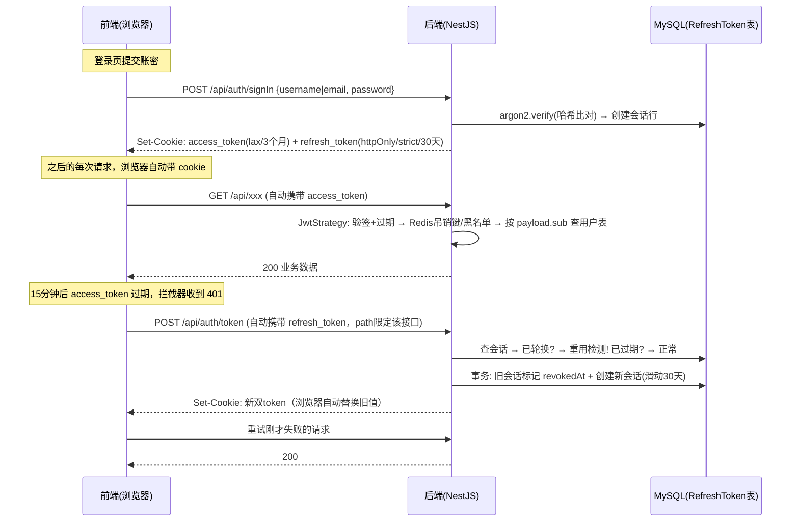

# ShareLink 认证方案：JWT 双 Token + Cookie 传输 + Refresh 轮换

> 对应实现：`backend-nest/src/auth/`（auth.service.ts / auth.controller.ts / strategy/jwt.strategy.ts）、`backend-nest/src/redis/`（redis.service.ts 黑名单封装）
> 技术栈：NestJS + Passport(passport-jwt) + @nestjs/jwt + argon2 + Prisma(MySQL) + Redis(ioredis) + express + cookie-parser

---

## 一、前置知识：认证方案演进与术语对齐

> 本节回答"在这套方案之前，业界是怎么做认证的、为什么会演进到双 Token"。
> 面试时先讲清这一节，再展开本项目实现（见 §2 总览与 §6 后端全流程），逻辑才完整。

### 1. 认证 vs 授权

- **认证（Authentication）**：你是谁——验证身份（账密、验证码、OAuth）。本文主题。
- **授权（Authorization）**：你能干什么——验证权限（isAdmin、资源归属）。认证的下游，本项目由守卫 + `isAdmin` 字段实现，不在本文展开。

### 2. 问题的起点：HTTP 是无状态协议

每个请求相互独立，服务器天然不记得"上一个请求是谁发的"。所以**一切认证方案的本质都是同一件事：让客户端每次请求携带某种身份凭证，服务器验证它**。方案之间的差异只在三点——凭证是什么、会话状态存在谁那里、签发后能否吊销。

### 3. 三代方案演进

**第一代：Session-Cookie（有状态）**

登录后服务端保存一份会话数据（内存 / DB / Redis），给浏览器下发一个**无含义的随机 sessionID** 存进 Cookie；之后每次请求自动带 cookie，服务端拿 ID 查会话。

- 优点：服务端全控——踢人、改权限即时生效；sessionID 本身无含义，泄露了也伪造不出什么（服务端删了就失效）
- 缺点：**有状态**——每个请求都要查存储；多实例部署必须解决"会话存哪"：分布式 session 三种解法——① sticky session（负载均衡把同一用户固定到同一实例）② 实例间 session 复制 ③ **集中存储（Redis）**，主流是 ③；对移动端 / 第三方接入也不友好（cookie 是浏览器的产物）

**第二代：JWT（无状态自包含）**

JWT = 三段 base64url 用点连接：`Header.Payload.Signature`——

```
Header    {"alg":"HS256","typ":"JWT"}                 声明签名算法
Payload   {"sub":"userId","exp":...,"iat":...}        claims（业务声明 + 注册声明）
Signature HMAC-SHA256(base64(header).base64(payload), secret)
```

服务器**验签即可信任 payload，不查任何存储**——天然横向扩展。两个必背性质：

- Payload 只是 base64 **编码、不是加密**，任何人拿到就能解码查看——绝不能放敏感数据
- 签名保证**不可篡改**（改一个字节签名就对不上），但不保密

代价：**签发后无法作废**——服务端没存它，谁持有谁合法，泄漏了只能等 `exp` 到期。由此催生两个工程手段：短有效期 + 吊销机制（见 §7 黑名单取舍）。

**第三代：双 Token（access + refresh）——现代 Web 标准形态**

| | access_token | refresh_token |
|---|---|---|
| 形态 | 短效 JWT（15 分钟） | 长效不透明凭证（30 天），服务端有记录 |
| 用途 | 业务请求携带，无状态验签 | 只用来换新 access，不碰业务接口 |
| 吊销 | 难（无状态）——靠短效兜底 | 易——删服务端记录即失效 |

本质：**把"无状态的性能"和"有状态的可控性"拆到两个凭证上，各取所长**。业界再往前一步是刷新时轮换 refresh（旧的立即作废）+ 重用检测（旧值再现 = 被盗信号）——OAuth 2.0 Security BCP 的推荐做法。本项目方案 = 第三代 + 轮换 + 重用检测 + Redis 黑名单的完整实现（§2 总览）。

### 4. 术语速查（读后文前先对齐）

| 术语 | 一句话解释 |
|---|---|
| Cookie 属性 | `httpOnly`（JS 不可读，防 XSS 窃取）/ `secure`（仅 HTTPS 传输）/ `sameSite`（strict=完全同站才带、lax=顶级导航 GET 也带、none=全带需 secure）/ `path`（哪些路径的请求携带）/ `maxAge`（寿命） |
| CSRF | 跨站请求伪造——恶意网站借用户浏览器**自动携带的 cookie** 伪造请求；防法：sameSite + CORS 白名单（+ CSRF token，本项目用 sameSite 覆盖） |
| XSS | 跨站脚本注入——恶意 JS 在受害者页面执行；对认证的威胁是偷 token；防法：httpOnly 让 JS 读不到 + 输出转义 + CSP |
| 引用凭证（by-reference） | 值本身无含义（如 uuid），有效性由服务端记录决定——sessionID、refresh_token 属此类 |
| 自包含凭证（by-value） | 值本身携带全部信息（JWT），验签即信任——快，但单方面作废难 |
| 吊销（revoke） | 让已签发的凭证提前失效；无状态 token 只能靠额外机制（黑名单 / 用户级版本戳 / 短效） |
| 轮换（rotation） | refresh 每使用一次就换新值，旧的立即作废 |
| 重用检测（reuse detection） | 已作废的 refresh 再次出现 = 被盗或并发异常 → 吊销该用户**全部**会话（家族吊销） |

---

## 二、一句话总览

**短效 JWT（15 分钟）通过 HttpOnly Cookie 携带做无状态鉴权；长效 refresh 会话（30 天）存在数据库，刷新时轮换（每次刷新旧 token 立即作废、签发新值），并通过"重用检测"识别 token 被盗——已作废的旧 refresh_token 再次出现即吊销该用户全部会话。**

- 传输层：**Cookie**（不是 Authorization: Bearer 头），双 token 均 `httpOnly`（JS 不可读）防 XSS 窃取，`sameSite` 防 CSRF
- access_token：JWT，无状态校验（不查库、不查 Redis），15 分钟过期
- refresh_token：随机 uuid，**只在数据库有记录才有效**，可随时删除实现即时吊销

---

## 三、全景流程图



---

## 四、关键参数速查表

| 项 | access_token | refresh_token |
|---|---|---|
| 形态 | JWT（自包含，验签即信任） | 随机 uuid，仅数据库有记录才有效 |
| 有效期 | **15 分钟**（JWT exp） | **30 天**（DB expiresAt），每次刷新滑动续期 |
| Cookie maxAge | 3 个月（沿旧后端约定，实际靠刷新续期） | 30 天 |
| httpOnly | **是**（2026-09-26 加固：JS 不可读，XSS 无法窃取到别处重放；浏览器自动携带，前端无需手动读） | **是**（脚本完全不可读） |
| sameSite | lax（跟随导航跳转携带） | **strict**（仅同站请求携带） |
| path | 默认 `/`（所有请求携带） | **`/api/auth/token`**（只有刷新接口可见，业务请求不会带上它） |
| secure | COOKIE_SECURE=true 时开启（https） | 同左 |
| 服务端存储 | 无状态；登出后 jti 写 Redis 黑名单（jwt:black:{jti}） | RefreshToken 表一行 |

JWT payload：

```json
{ "sub": "用户id", "email": "邮箱", "isAdmin": false, "refreshTokenId": "会话id", "jti": "token唯一标识(黑名单用)", "iat": ..., "exp": 15分钟后 }
```

RefreshToken 表：`id / token(uuid, unique) / createdAt / expiresAt / revokedAt(轮换时间) / userId(Cascade, 索引)`

User 表激活相关（2026-09-27 signUp 引入，2026-10-01 改验证码）：`isActivated / activationToken(unique, 6 位数字码) / activationTokenExpiresAt` —— 开启邮箱验证时使用；验证码 10 分钟有效、一次性、错 5 次锁死、重发即轮换并清零计数

---

## 五、前端视角：请求从哪发、怎么带、怎么续

### 1. 注册与邮箱激活（新用户入口）

```js
// 注册：credentials 必须，注册成功即自动登录（双 cookie 由 Set-Cookie 写入）
await fetch('http://localhost:3000/api/auth/signUp', {
  method: 'POST',
  headers: { 'Content-Type': 'application/json' },
  credentials: 'include',
  body: JSON.stringify({ username: 'alice', email: 'a@b.com', password: '********' }),
});
```

- 开发环境 / 首个用户：直接返回 201 `{ accessToken, user }`，与登录等效
- 开启邮箱验证（`ENABLE_EMAIL_VERIFICATION=true`）：返回 201 `{ verificationRequired: true }`（**不带任何 token**），提示用户查收激活邮件
- 激活（2026-10-01 起为验证码形式）：邮件给出 6 位数字码，用户在注册页回填 `POST /api/auth/verifyEmail { email, code }`（**POST body——码绝不出现在 URL**，浏览器历史/访问日志/Referer 都是泄漏面；GET 链接形式还有被邮件服务商预扫描提前消费一次性 token 的风险）；错误/过期/已用 → 401，前端引导走 `POST /api/auth/resendVerification` 重发
- 未激活直接登录 → 401「邮箱未验证，请先完成邮箱激活」

### 2. 登录（用户主动行为）

```js
// 必须带 credentials，否则跨域时 Set-Cookie 和后续 Cookie 携带都不生效
await fetch('http://localhost:3000/api/auth/signIn', {
  method: 'POST',
  headers: { 'Content-Type': 'application/json' },
  credentials: 'include',                 // 跨域必须；同源用默认即可
  body: JSON.stringify({ username: 'admin', password: '123456' }),
});
```

- 响应：200 `{ accessToken }`（2026-09-27 起 signIn 响应体不再返回 refreshToken——浏览器靠 Set-Cookie 自动获得，响应体是 XSS 拿到长效凭证的唯一残留通道，已封死）
- 之后**前端代码不需要任何手动存取 token 的逻辑**——浏览器把 HttpOnly cookie 存好后自动管理

### 3. 业务请求（无感知）

```js
// 什么都不用做，浏览器自动带 access_token cookie
await fetch('http://localhost:3000/api/shares', { credentials: 'include' });
```

- refresh_token 的 cookie path 限定 `/api/auth/token`，所以业务请求**只会带 access_token**，不会暴露长效凭证

### 4. 静默续期（axios 拦截器示例，前端唯一需要写的逻辑）

> **`/auth/token` 何时被调用**：唯一调用方是前端响应拦截器，唯一触发条件是"受保护请求收到 401"（access 到期 / 页面挂起后恢复）。并发 401 共享同一个 refreshing promise 只调一次；token 未过期、公开接口、登录页都不会触发——没有定时器预刷新，它是纯粹的被动急救通道。

```js
let refreshing = null; // 并发 401 时只发起一次刷新

api.interceptors.response.use(null, async (error) => {
  const { config, response } = error;
  if (response?.status !== 401 || config._retried) throw error;
  config._retried = true; // 防死循环

  refreshing = refreshing ?? api.post('/auth/token', null, { _skipAuth: true });
  try {
    await refreshing;       // 新 token 已由 Set-Cookie 写回浏览器
    return api(config);     // 重试原请求
  } catch {
    location.href = '/login'; // 刷新也失败：会话彻底失效，回登录页
    throw error;
  } finally {
    refreshing = null;
  }
});
```

流程：业务请求 401 → `POST /api/auth/token`（浏览器自动带 refresh_token）→ 服务端轮换下发新 cookie → 自动重试原请求 → 用户全程无感知。

---

## 六、后端全流程（核心接口逐段拆解）

### 1. `POST /api/auth/signUp` — 注册（邮箱验证开关）

```
1. DTO 校验：username 3-30 位（字母/数字/_/-）、email 格式、password 8-64 位
2. isFirstUser = user.count() === 0 → 首个注册者自动 isAdmin，且跳过邮箱验证
3. email.trim().toLowerCase() 归一化入库（与 signIn 的小写查询约定一致）
4. needsVerification = !isFirstUser && ENABLE_EMAIL_VERIFICATION === 'true'
   ├─ true  → 落库时写 activationToken(randomInt 6 位数字码, 10 分钟有效)，验证码交 EmailService 投递（MAIL_DELIVERY=log|smtp）
   │          → 201 { verificationRequired: true }，不下发任何 token
   └─ false → argon2 哈希落库 + generateToken → 201 双 cookie + { accessToken, user }
5. P2002 唯一约束冲突 → 409「邮箱或用户名已被注册」
6. 限流：@Throttle 10 次/小时（防脚本批量灌号；全局另有 100 次/分钟）
```

关联接口（激活闭环，2026-10-01 起为验证码形式）：

- `POST /api/auth/verifyEmail { email, code }`（10 次/小时）：按 email 查用户 → **先查锁**（`verify:fail:{email}` 原子计数 ≥5 直接拒绝，撞对也不放行）→ 比对码 + 10 分钟过期检查 → `isActivated=true` 并**清空码字段**（一次性）→ 清计数。错误 → 401「验证码错误或已过期」并自增失败计数；超限 → 401「错误次数过多，请稍后重新获取验证码」
- `POST /api/auth/resendVerification`（5 次/小时）：仅对未激活用户重发并**轮换新码**（旧码立即作废）+ 清空失败计数（新码配完整 5 次机会）；邮箱不存在或已激活一律返回同一句「如果该邮箱需要激活，激活邮件已发送」——**固定话术防账号枚举**
- signIn 侧联动：密码校验通过但 `isActivated=false` → 401「邮箱未验证，请先完成邮箱激活」（放在密码校验之后，避免未持密码者探测账号激活状态）

> 链接 → 验证码的安全模型变化：uuid 链接的安全性来自 2^122 熵，天然不可穷举；6 位码空间仅 10^6，**安全责任从随机性转移到频控**——短过期（10 分钟）+ 错 5 次锁死 + 接口限流三件套缺一不可，且锁死判断必须在码比对之前。

### 2. `POST /api/auth/signIn` — 签发

```
1. DTO 校验（ValidationPipe）：email 或 username 必须提供其一
2. 查库 findFirst({ OR: [{email}, {username}] })
3. argon2.verify(库中哈希, 明文密码)  ← argon2id，密码从不明文落库
4. 失败 → warn 日志（含来源 ip）+ 401「邮箱/用户名或密码错误」
5. generateToken(user)：
   a. RefreshToken 表插入会话行（token=uuid, expiresAt=now+30天）
   b. 签发 access JWT：payload={sub,email,isAdmin,refreshTokenId}，15分钟
6. addTokensToResponse：双 token 写入 Set-Cookie（属性见上表）
7. 限流：@Throttle 5 分钟 20 次（全局另有 100 次/分钟）
```

### 3. 业务接口鉴权 — `JwtStrategy` 校验链（验签无状态，另加两级 Redis 吊销检查）

```
1. fromExtractors: 只从 req.cookies.access_token 提取（不走 Bearer 头）
2. 验签 + 过期检查（本地 CPU 完成，ignoreExpiration: false）
3. Redis 用户级吊销键：payload.iat < auth:revoke:{sub} 时间戳 → 401（封禁/改密踢下线）
4. Redis 单 token 黑名单：isInBlackList(jti) → jwt:black:{jti} 存在 → 401（登出即时失效）
5. validate(payload): 返回 payload 本身（passport 挂到 req.user，主流形态）；User 实体由 JwtAuthGuard 按 payload.sub 查库补充（req.currentUser，每请求仅查一次；用户已删除 → 401）
6. controller 注入：@CurrentUser() 读 req.currentUser（User 实体）、@GetJwtPayload() 读 req.user（验签后 payload，登出用它取 jti/refreshTokenId）

（Redis 故障时 ③④ 由 RedisService fail-open 降级为"未命中"，退化为无黑名单状态并 error 告警）
```

守卫是**按路由挂载**（`@UseGuards(JwtAuthGuard)`），公开接口天然不受影响。

### 4. `POST /api/auth/token` — 轮换 + 重用检测（方案核心）

```
1. 无 refresh_token cookie → 401「缺少 refresh_token」
2. 查会话（含 user）
   ├─ 查不到                     → 401「会话不存在」+ warn 日志（伪造或已被清理）
   ├─ revokedAt 非空（已轮换过！） → 【重用检测，疑似被盗】
   │    └─ deleteMany 该用户全部会话 → warn 日志「已吊销其全部会话（N 个）」→ 401「检测到会话异常」
   ├─ expiresAt < now            → 删除该行 → 401「会话已过期」
   └─ 正常 → 3
3. 事务轮换（防止并发刷新产生双活会话）：
   旧会话 UPDATE revokedAt = now  +  INSERT 新会话（expiresAt = now+30天，滑动续期）
4. 用新会话 id 签发新 access JWT → Set-Cookie 下发新双 token
```

**重用检测的判定逻辑**：正常轮换后旧 refresh_token 会被标记 revokedAt。如果它再次出现，只可能是——攻击者偷到了旧值重放，或两个客户端共用同一会话。无论哪种都直接**全家族吊销**：真用户和攻击者的会话一起作废，攻击者无法静默存活，真用户最多重新登录一次。

### 5. `POST /api/auth/signOut` — 主动登出

```
1. 无状态 decode access_token（不验签——只是读 payload）
2. 有 jti → setBlackList(jti, 剩余寿命秒数) → SET jwt:black:{jti}（access_token 立即失效，键 15 分钟内自动清理）
3. 有 refreshTokenId → DELETE 该会话行（refresh_token 立即失效）
4. 双 cookie maxAge 置 -1 立即清除 → 204
```

**用户级吊销 `revokeAllUserTokens(userId)`**（封禁/修改密码/管理员强制下线时调用）：
设 `auth:revoke:{userId}` = 当前时间戳（TTL = 15 分钟）+ 删除该用户全部 RefreshToken 会话。语义：**吊销时刻之前签发的所有 access_token 立即失效**，吊销之后新登录的 token 不受影响（能否再登录由封禁状态等业务逻辑决定）。

**忘记密码闭环（2026-09-30 接入）**：

```
requestPasswordReset(email)         resetPassword(token, newPassword)
  ├─ 邮箱不存在 → 同话术返回            ├─ token 查库 + 1h 过期校验 → 400 无效或已过期
  │  （防账号枚举，响应零差异）          ├─ argon2id 哈希写入 + 清空重置 token（一次性，重放 400）
  └─ 存在 → 随机 uuid 重置 token        └─ revokeAllUserTokens(userId)：重置即踢下线——
     （User 表字段，1 小时有效，            盗号场景下旧 access 靠用户级吊销键立即失效，
      重发即轮换旧的）                      旧 refresh 会话全部删除，盗号者必须重新拿到密码
```

要点：重置凭证与激活凭证同构存 User 表（同一时刻至多一个有效 token）；密码/激活/重置凭证及过期时间**一律不出现在任何 API 响应**（`stripPassword`/`me` 脱敏对齐）。

---

## 七、安全设计：威胁 → 对策（面试要点）

| 威胁 | 对策 | 原理 |
|---|---|---|
| XSS 偷 token | 双 token 均 `httpOnly` + 响应体零凭证 | JS 读不到任何 token cookie，signIn/token 响应体也不再返回 refreshToken（2026-09-27 收口）——XSS 无法把凭证偷到别处重放 |
| CSRF | refresh `sameSite: strict` + access `lax` + CORS 白名单 credentials | 跨站请求带不上 cookie；lax 仍允许顶级导航 GET（外链跳转）保体验 |
| refresh_token 被盗 | **轮换 + 重用检测 + 家族吊销** | 盗用的旧值一刷新就触发全员下线（OAuth 2.0 BCP 推荐做法） |
| access_token 被盗 | 15 分钟短效 | 泄漏窗口被压到 15 分钟；窗口内风险用 Redis 黑名单可进一步压到 0（见"取舍"） |
| 暴力破解 | argon2id + 接口限流 20次/5分钟 | argon2 抗 GPU，故意慢；限流封 IP 维度 |
| 脚本批量注册灌号 | signUp 限流 10 次/小时 + argon2 慢哈希 | 高频注册被限流器拦截；慢哈希让每次注册的 CPU 成本抬高，批量灌号不划算 |
| 账号枚举（探测某邮箱是否已注册） | resendVerification 固定话术；signIn 错误信息不区分「账号不存在/密码错误」 | 响应差异是枚举的信号源，统一话术后无法区分存在与不存在；未激活的 401 也放在密码校验通过之后才抛 |
| 验证码被猜测/爆破（2026-10-01 换码后） | randomInt 密码学随机 + 一次性（激活即清空）+ 10 分钟有效 + 错 5 次锁死（Redis 原子计数，锁在比对之前）+ 接口限流 10/h | 10^6 小码空间的安全性不靠熵靠频控：无锁时 10^6 组合在限流下仍可慢速爆破，"5 次锁死 + 撞对也不放行"把单码可尝试次数压到 5；重发轮换新码并清零计数，码生命周期与计数器对齐 |
| refresh 泄漏面过大 | cookie path 限定 `/api/auth/token` | 只有刷新接口可见，业务请求、日志、抓包里都不会出现长效凭证 |
| 跨域凭证丢失 | `enableCors({origin: 白名单, credentials: true})` | credentials 模式下 CORS 不允许 `*`，必须显式白名单 |

### 关键取舍（面试加分项）

**为什么 JWT 双 token 而不是纯服务端会话（Redis 存 session）？**
access 校验完全无状态——不查 Redis、不查存储，扩展多实例时无需共享会话存储；吊销能力由"有状态的 refresh"补齐：删一行 DB 记录 refresh 即失效。两全其美：**无状态的性能 + 有状态的可控性**。

**Redis 黑名单（已实现，2026-09-23）：为什么是黑名单而不是白名单？**
黑名单只在需要吊销时写（登出/封禁，低频），Redis 数据丢失仅退回 15 分钟窗口的现状；白名单每次登录都写、Redis 丢失即全员下线。两级设计：
- 单 token 级 `jwt:black:{jti}`（`setBlackList`/`isInBlackList`），TTL = 剩余寿命：登出即时失效
- 用户级 `auth:revoke:{userId}`（通用 set/get），值为吊销时间戳、TTL = 15 分钟：封禁/改密让"此刻之前签发的所有 token"失效，一个键搞定，不用逐个枚举

**Redis 挂了会怎样？（降级思维）**
黑名单检查 fail-open：故障降级为未命中并 error 告警——退化为无黑名单的现状，而不是把登录体系打挂。依赖组件故障时系统应"降级"而非"宕机"。降级逻辑收敛在 `RedisService`（`src/redis/redis.service.ts`）封装层：try/catch + `enableOfflineQueue: false` 快速失败都在这一个文件里，auth.service / jwt.strategy 完全无感。

**为什么登出后 access_token 曾经还能活 15 分钟？**
历史取舍：该 token 在登出者自己浏览器里，风险低。2026-09-23 已引入 jti 黑名单，登出即时失效（见上）。

---

## 八、面试高频 Q&A

**Q1：token 放 localStorage 还是 Cookie？**
A：HttpOnly Cookie。localStorage 任何 XSS 都能读走长效 token；httpOnly 脚本不可读。代价是要处理 CSRF（sameSite + CORS 白名单）和跨域时的 credentials 配置。

**Q2：为什么 access_token 要 15 分钟这么短？**
A：JWT 签发后无法作废（无状态），有效期内泄露无法补救。短有效期把不可控窗口压到 15 分钟，续期成本由用户无感知的静默刷新承担。期限写在 exp 字段随 token 走（服务器不存储），且重签是前端 401 拦截器驱动的——服务器没有任何主动续期/定时任务。

**Q3：refresh_token 被偷了怎么办？你的方案怎么发现？**
A：靠轮换+重用检测。每次刷新旧 refresh 立即作废（保留 revokedAt 行），旧值再次出现 = 被盗信号，直接删该用户全部会话。这是 OAuth 2.0 BCP 的标准做法。攻击者最多拿到 30 天里"从未被使用窗口"的旧值——只要真用户刷新过一次，盗用即暴露。

**Q4：JWT 怎么登出？**
A：分两层。refresh 是 DB 会话，删行即真实登出；access 靠 jti 黑名单即时吊销——登出时把 jti 写 Redis（TTL=剩余寿命），鉴权时多查一次，键到点自动清理。

**Q5：两个标签页同时 401，会不会把对方的新会话刷掉（重用误伤）？**
A：分两层。**同页并发**：前端刷新去重（共享同一个 refreshing promise，只发一次 /token），后端事务保证"标记作废+建新会话"原子完成。**跨标签页**：两个页面没有共享锁，若在毫秒级窗口内同时刷新——A 先轮换成功，B 带着同一个旧 refresh 撞上 revokedAt → 误触发重用检测 → 家族吊销，用户被踢回登录页。当前取舍：概率极低、后果仅重登一次，接受。业界修法：① BroadcastChannel/localStorage 锁选"主标签页"单飞刷新；② 服务端宽限期（Auth0 grace period）——revokedAt 在 N 秒内的重用视为并发刷新而非盗用。

**Q6：为什么用 argon2 不用 bcrypt？**
A：argon2 是 2015 密码哈希竞赛冠军，抗 GPU/ASIC，内存硬化；bcrypt 在高核显机器上并行成本低。两者都远好于 md5/sha 系，新项目首选 argon2id。

**Q7：多实例部署，这个方案要改吗？**
A：不用。无状态的部分（JWT 验签）各实例独立；有状态的部分在 MySQL（RefreshToken 表），天然共享。这正是当初不把会话放单机内存/本地 Redis 的原因。

**Q8：如果要支持移动端 App 怎么办？**
A：App 存不了浏览器 cookie，需在 JwtStrategy 的 fromExtractors 里补 Bearer 头提取作为第二通道（`Authorization: Bearer <access>`），并把 refresh_token 从 HttpOnly cookie 改为响应体返回、由 App 存 Keychain/Keystore。轮换与重用检测逻辑完全复用。

**Q9：这套方案是主流吗？**
A：分三层定位。**标配骨架**（双 token、argon2、httpOnly cookie）是 OAuth 2.0/OIDC 生态的标准形态（Auth0/Supabase/Firebase 同款）；**进阶实践**（refresh 轮换 + 重用检测 + 家族吊销）是 OAuth 2.0 Security BCP 推荐，多数业务团队没做，属于加分项；**自选增强**（Redis 黑名单）按"即时吊销"需求选配。注意：我们不是完整 OAuth 2.0 授权框架（无 authorization_code/scope/第三方授权），而是 first-party 认证会话方案——自研产品的正确选择；token 走 Set-Cookie 而非响应体也是 first-party 场景的安全变形。若被问"为什么不用 X"：纯服务端 session 每请求查存储、横向扩展要共享存储；Redis 白名单丢库即全员下线；PASETO 理念更好但生态小众。

**Q10：refresh_token 只是随机 UUID，"泄露了也不要紧"对吗？**
A：错，它是系统里**最敏感**的凭证（access 15 分钟自灭，refresh 能活 30 天且可续命）。"只是 UUID"描述的是内容无含义——它是**引用凭证**（by-reference，取件码），价值在服务端认它：凭它可换全权限新 access。泄露时间线：攻击者调 /auth/token → 得到新 access + 新 refresh（成为"合法当前持有者"）→ 受害者手里的 refresh 反成 revoked 旧值 → 受害者下次刷新先触发重用检测被踢。所以轮换 + 家族吊销提供的是"高概率暴露 + 损失有界"，不是"泄露无害"。正确表述：凭证的价值 = 服务端背书的能力，与字符串内容复杂度无关（类比：银行卡密码也只是 6 位数字）。

---

## 九、已知短板与演进方向

| 短板 | 演进 |
|---|---|
| ~~登出后 access 最长存活 15 分钟~~ | 已解决（2026-09-23）：Redis jti 黑名单，TTL=剩余寿命，鉴权多一次 GET |
| ~~无"管理员强制下线"能力~~ | 已解决（2026-09-23）：`revokeAllUserTokens(userId)` 用户级吊销键 + 清全部 refresh 会话；忘记密码（2026-09-30）与管理员接口均已接入调用 |
| ~~revokedAt 行永久保留（重用检测需要）~~ | 已解决：过期行由定时任务清理——原 auth 模块 `RefreshTokenCleanupService`（每天 3 点，`CLEANUP_CRON` 可覆盖）**已于 2026-10-08 并入 [jobs 模块](./jobs-scheme.md) 的 `deleteExpiredTokens`（`CLEANUP_CRON` 随之移除，全项目 @Cron 收敛一处）**。保留规则不变：`expiresAt > now` 的 revoked 行必须留着（重用检测证据），旧 token 一旦自然过期即失去刷新能力，可安全删除 |
| ~~signIn/refresh 响应体返回 refreshToken（XSS 可借响应体绕过 httpOnly）~~ | 已解决（2026-09-27）：两个接口响应体均只返回 accessToken，refresh 仅经 Set-Cookie 下发 |
| ~~激活邮件走日志投递（SMTP 未接入）~~ | 已解决（2026-10-03）：EmailService（src/email，nodemailer）统一投递，`MAIL_DELIVERY=log` 日志投递（开发默认）/ `smtp` 真实发信（fail-open：发送失败仅 WARN 不阻断主流程）；本地联调用 mailpit（docker-compose）或 maildev，见 [email-scheme.md](./email-scheme.md) |
| 跨标签页并发刷新可能误触发重用检测 | 概率极低（毫秒级窗口），损失上限=重登一次；演进：BroadcastChannel 单飞 / 服务端宽限期 |
| 仅支持浏览器 cookie 通道 | fromExtractors 补 Bearer 提取，响应体下发 refresh |
| access cookie maxAge 3 个月偏长（旧后端约定） | 无实际风险（JWT 15 分钟），但可缩短到 1 天更干净 |
